<div align="center">


<br>

```
 ██████╗ ███████╗██╗   ██╗███████╗██╗      ██████╗ ██████╗ ███████╗██████╗
 ██╔══██╗██╔════╝██║   ██║██╔════╝██║     ██╔═══██╗██╔══██╗██╔════╝██╔══██╗
 ██║  ██║█████╗  ██║   ██║█████╗  ██║     ██║   ██║██████╔╝█████╗  ██████╔╝
 ██║  ██║██╔══╝  ╚██╗ ██╔╝██╔══╝  ██║     ██║   ██║██╔═══╝ ██╔══╝  ██╔══██╗
 ██████╔╝███████╗ ╚████╔╝ ███████╗███████╗╚██████╔╝██║     ███████╗██║  ██║
 ╚═════╝ ╚══════╝  ╚═══╝  ╚══════╝╚══════╝ ╚═════╝ ╚═╝     ╚══════╝╚═╝  ╚═╝
```

<a href="https://git.io/typing-svg"></a>

<br>

[](https://www.linkedin.com/in/ahmedmoustafaelashry)
[](https://github.com/AhmedElashry20)
[](mailto:ahmedmoustafaelashry@gmail.com)
[](#)


</div>

---

## `> cat about.txt`

```js
const ahmed = {
    role: "Senior Full-Stack & Mobile Developer",
    company: "Bin Rabie Holding Group",
    location: "Riyadh, Saudi Arabia",
    experience: "8+ years",
    education: "Bachelor of Computers and Information — Tanta University (2018), Very Good",
    languages: ["Arabic (Native)", "English (C1)", "Italian (B1)"],

    expertise: {
        mobile:     "Flutter · Dart · Firebase · Android · iOS",
        frontend:   "React · TypeScript · HTML5 · CSS3 · Tailwind",
        backend:    "Node.js · NestJS · Express · Fastify · ASP.NET Core",
        database:   "PostgreSQL · MongoDB · SQL Server · Firebase",
        cloud:      "Oracle Cloud · AWS · Docker · Nginx · PM2",
        security:   "OWASP · Penetration Testing · Endpoint Security",
        tools:      "Git · CI/CD · Prisma · Linux Administration"
    },

    currentFocus: "Building enterprise systems & scaling mobile apps"
};
```

---

## `> ls tech-stack/`

<div align="center">


</div>

---

## `> ls projects/ --featured`

<br>

<!-- ==================== SUFRA ==================== -->
<div align="center">

### `01` Sufra (سُفرة) — Multi-tenant SaaS for Restaurants & Cafés
**`NestJS · Prisma · PostgreSQL · Next.js · Capacitor`**

-555555?style=flat-square&logo=github)


</div>

```
 One platform, many venues — each with its own data, staff accounts and branding
 ├── 🧾 POS · Kitchen display · Tables · Menu & orders        (every plan)
 ├── 📦 Inventory · Reservations · Loyalty · Reports          (higher plans)
 ├── 🏢 CRM · Accounting · Payroll · Multi-branch              (Business)
 └── 📱 Diner app (Capacitor) — WhatsApp-code sign-in, live order tracking
```

<br>

---

<br>

<!-- ==================== AL-MAQAR ==================== -->
<div align="center">

### `02` Al-Maqar (المقر) — AI Workforce Platform
**`TypeScript · Fastify · Next.js · PostgreSQL + pgvector · Docker`**

-555555?style=flat-square&logo=github)


</div>

```
 A team of AI agents that split work, hand it off, and wait for approval
 ├── 🗂️  Task board + per-department channels + live network view
 ├── 🔐 Tool permissions enforced in code, per-agent daily budget caps
 ├── 🔁 Postgres job queue (FOR UPDATE SKIP LOCKED), retries with backoff
 └── 🧾 No task closes without a receipt (file or link that proves it)
```

<br>

---

<br>

<!-- ==================== QADIR FOOD ==================== -->
<div align="center">

### `03` Qadir Food — Saudi Delivery Platform
**`Flutter · React · NestJS · PostgreSQL`**

[](https://github.com/AhmedElashry20/qadirfood)
[](https://qadirfood-admin.onrender.com/login)


</div>

```
 Full delivery platform for Saudi Arabia
 ├── 📱 Customer · Captain · Restaurant apps (Flutter)
 ├── 🖥️  Admin & Restaurant panels (React) — live dispatch, settlements
 └── ⚙️  Realtime backend (NestJS) — order state machine, GPS tracking

 Payments: Moyasar · Invoicing: ZATCA · Captain wallet · Fleet settlements
```

<br>

---

<br>

<!-- ==================== SHIFA CARE ==================== -->
<div align="center">

### `04` Shifa Care — Hospital Booking, Telemedicine & Hospital ERP
**`Flutter · Flutter Web · Dart · PHP API`**


[](https://hospital.ct.ws)


</div>

```
 Multi-branch hospital platform — 3 apps on one live API
 ├── 📱 Patient App (Flutter) — Book by branch, live queue ticket, video/voice/chat
 │                              consults, e-prescriptions, pharmacy orders, health log
 ├── 🩺 Doctor App (Flutter)  — Clock-in per branch, live queue, consult timer,
 │                              visit notes & prescriptions visible to patient instantly
 ├── 🖥️  Hospital ERP (Web)    — Queue screen, branches, bookings, pharmacy & inventory,
 │                              HR & payroll, finance, insurance claims, RBAC
 └── ⚙️  REST API (Dart)       — Single source of truth · slot locking · real-time sync

 Linked modules: payroll → expenses · PO receipt → stock + expenses
                 prescription → pharmacy stock → pharmacy revenue
```

<div align="center">

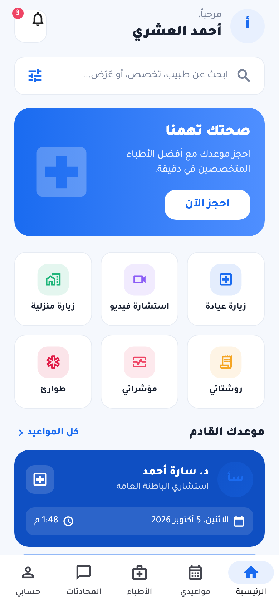
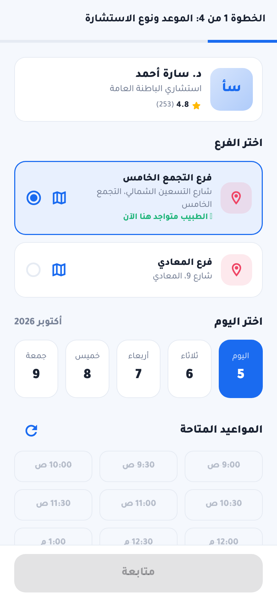
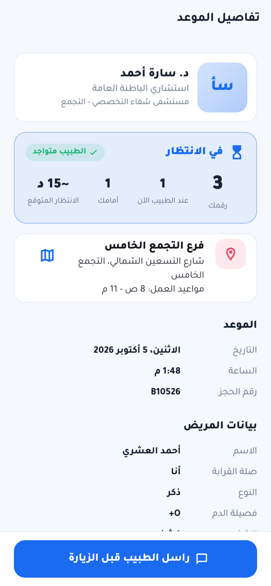
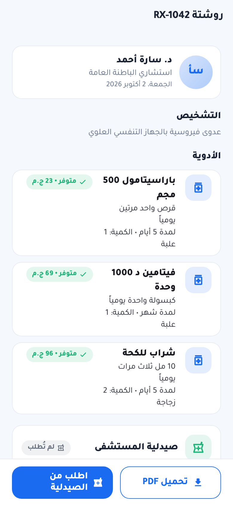
<br><br>
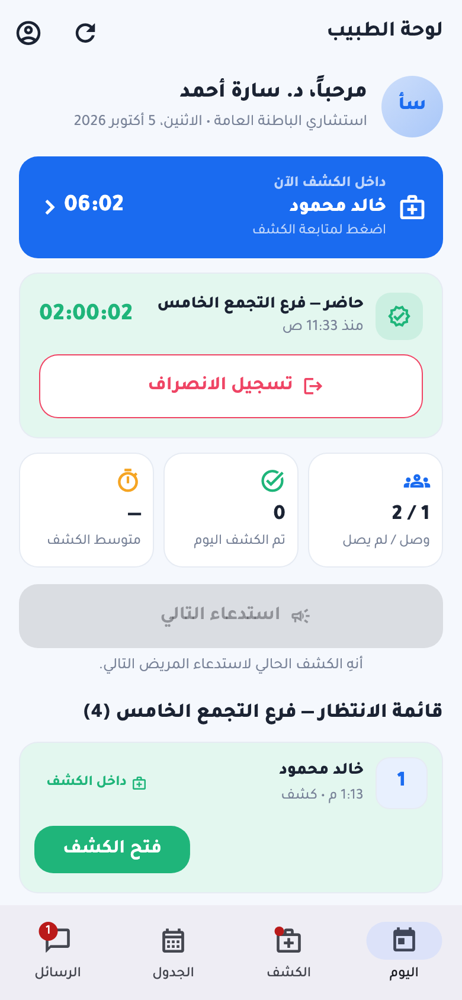
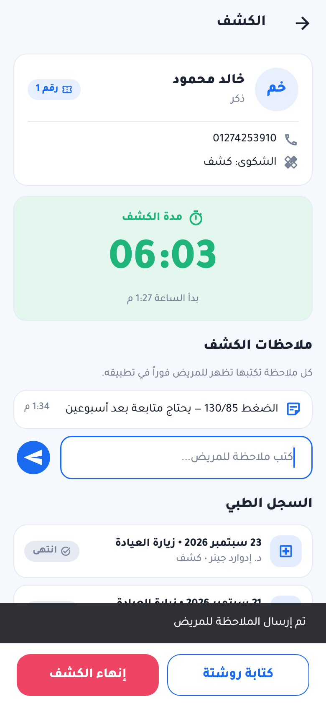
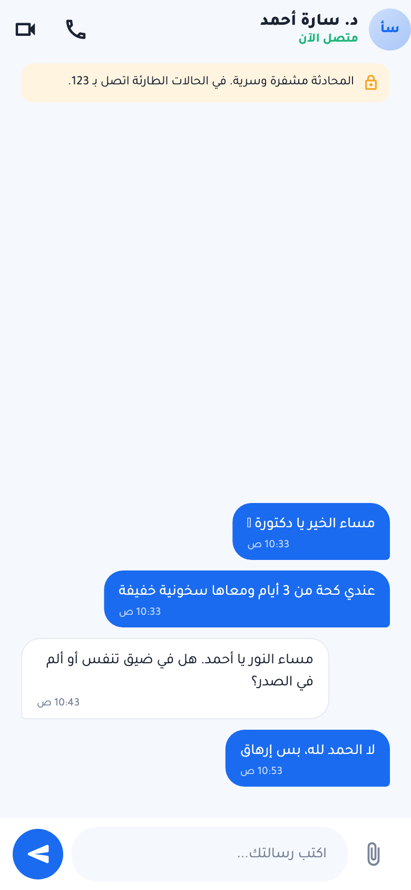
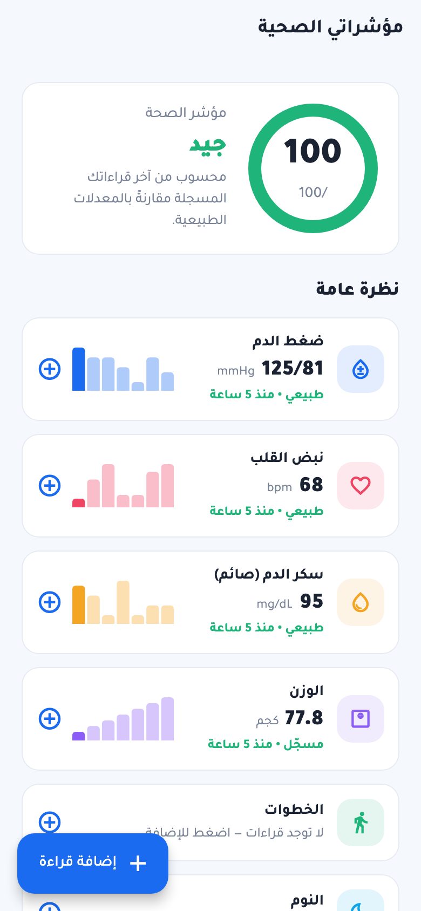
<br><br>
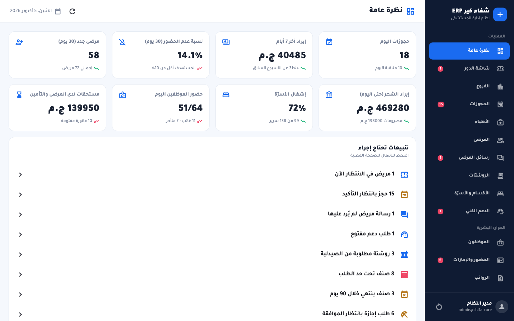
<br><br>
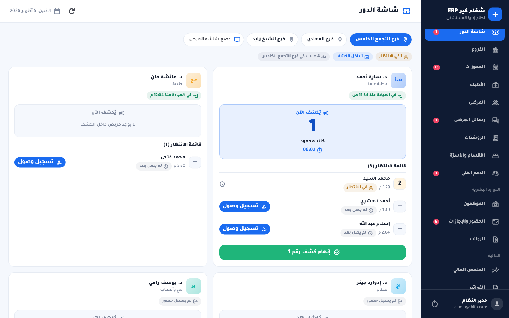
<br><br>
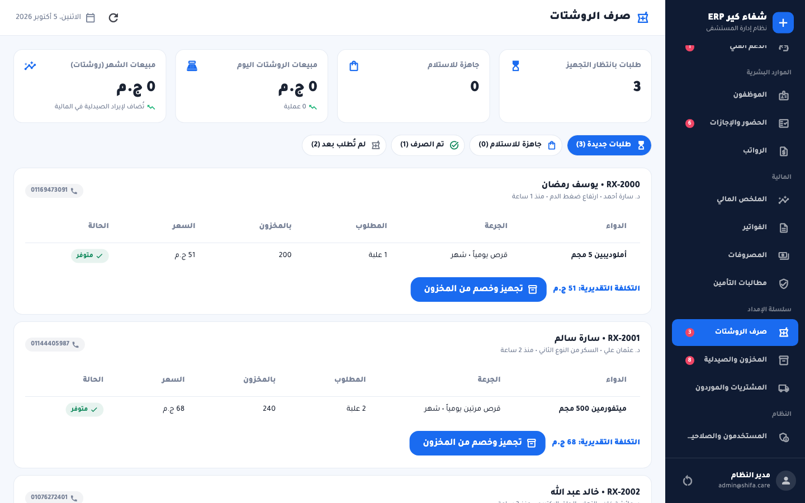
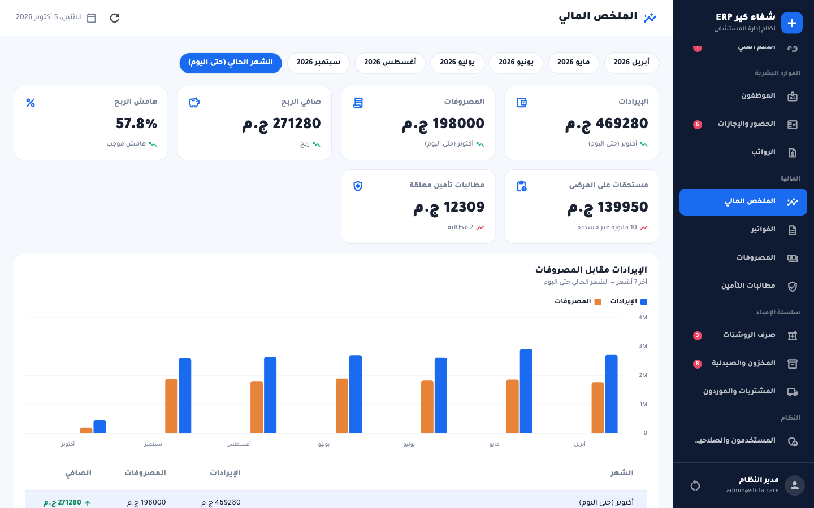

</div>

<br>

---

<br>

<!-- ==================== MISR E-VOTING ==================== -->
<div align="center">

### `05` Misr (مصر) — E-Voting Platform for Elections & Referendums
**`Flutter · React · TypeScript · Node.js · PostgreSQL · Prisma`**

[](https://github.com/AhmedElashry20/egypt-app)


</div>

```
 Secure e-voting platform with an Egyptian Pharaonic identity (Arabic / RTL)
 ├── 📱 Citizen App (Flutter) — National ID + linked mobile → SMS OTP login,
 │                              elections · referendums · polls, vote receipts
 ├── 🖥️  Admin Dashboard (React) — Turnout analytics, ballot lifecycle,
 │                              voter roll (add / import / edit), admin accounts
 └── ⚙️  REST API (Node.js)      — Ballot secrecy (who voted ≠ what was voted),
                                 one vote per citizen under concurrency

 Security: Argon2id + lockout · append-only DB triggers · HMAC-chained audit log
           timing-safe OTP · SMS-pumping circuit breaker · encrypted tested backups
```

<div align="center">


<br><br>

<br><br>


</div>

<br>

---

<br>

<!-- ==================== ELASHRY AI ==================== -->
<div align="center">

### `06` Elashry AI — VS Code Assistant + Model Trained From Scratch
**`Python · LLM · VS Code`**

[](https://github.com/AhmedElashry20/elashry-ai)


</div>

```
 Personal coding assistant for VS Code
 ├── 🧠 Language model — 17.9M parameters, trained from scratch
 │                       on 2.61B tokens across 88 programming languages
 └── 🤖 Agent — tools, skills, deterministic goal checks, permissions
```

<br>

---

<br>

<!-- ==================== QADIR ==================== -->
<div align="center">

### `07` qadir.sa — VIP Ride-Hailing Platform
**`Flutter · React · Node.js · PostgreSQL · GPS · Mada/Apple Pay`**


[](https://qadir.sa)

</div>

```
 Premium VIP ride-hailing platform for Saudi Arabia
 ├── 📱 Passenger App (Flutter) — Book VIP rides, schedule in advance
 ├── 🚘 Driver App (Flutter) — Manage trips, earnings, navigation
 └── 🖥️  Admin Dashboard (React) — Fleet ops, analytics, management

 Features: Real-time GPS · Pre-scheduled rides · Luxury fleet
           Mada/Apple Pay · Bilingual AR/EN · Push notifications
```

<br>

---

<br>

<!-- ==================== COURIER MANAGEMENT ==================== -->
<div align="center">

### `08` Courier Management System — Enterprise Dashboard
**`Node.js · React · TypeScript · PostgreSQL · Prisma`**

-555555?style=flat-square&logo=github)


</div>

```
 Full internal management system for Bin Rabie Express
 ├── 📊 Operations — Shipment stats, Excel import, KPI dashboard
 ├── 💰 Salary Engine — Complex multi-tier calculation workflows
 ├── 🚛 Fleet Management — Vehicle tracking, maintenance, fuel logs
 ├── 👥 HR Module — Employees, attendance, leave management
 └── 🔐 RBAC — Role-based access (Admin / Manager / Viewer)

 Replaced all Excel-based workflows with centralized digital platform
```

<br>

---

<br>

<!-- ==================== QADIR GOLD ==================== -->
<div align="center">

### `09` Qadir Gold — Online Gold Store
**`TypeScript · NestJS · React · PostgreSQL`**

[](https://github.com/AhmedElashry20/qadir-gold-store)

</div>

```
 Jewellery and investment bullion, priced live from the per-karat gram rate
 ├── 🌐 Arabic / English with full RTL, six display currencies
 ├── 🚚 56-country shipping zones
 └── 🔒 Price snapshot frozen at purchase
```

<br>

---

<br>

<!-- ==================== FIXGO ==================== -->
<div align="center">

### `10` FixGo — On-Demand Home Services Platform
**`Flutter · Firebase · Node.js`**


</div>

```
 Multi-role on-demand home services platform
 ├── 🏠 Client App — Request and track home services
 ├── 🧰 Technician App — Manage jobs and earnings
 └── 👮 Captain App — Supervise technicians and job quality

 3 Flutter apps working in sync across Saudi Arabia
```

<br>

---

<br>

<!-- ==================== ENDPOINT SECURITY ==================== -->
<div align="center">

### `11` Endpoint Security Monitor — Corporate Security Tool
**`Python · Flask · Socket.IO`**

[](https://github.com/AhmedElashry20/endpoint-security-monitor)


<br><br>


</div>

<br>

---

<br>

<!-- ==================== BIN RABIE HOLDING ==================== -->
<div align="center">

### `12` Bin Rabie Holding Group — Corporate Website
**`binrabiegroup.sa`** · HTML · CSS · JavaScript

[](https://github.com/AhmedElashry20/bin-rabie-holding)


<br><br>

<br><br>


</div>

<br>

---

<br>

<!-- ==================== BIN RABIE EXPRESS ==================== -->
<div align="center">

### `13` Bin Rabie Express — Courier & Logistics Website
**`HTML · CSS · JavaScript`**

[](https://github.com/AhmedElashry20/bin-rabie-express)


<br><br>

<br><br>


</div>

<br>

---

<br>

<!-- ==================== BIN RABIE FOOD ==================== -->
<div align="center">

### `14` Bin Rabie Food — Restaurant Delivery-Fleet Company Website
**`HTML · CSS · JavaScript`**

[](https://github.com/AhmedElashry20/bin-rabie-food)


<br><br>

<br><br>


</div>

<br>

---

<br>

<!-- ==================== DOM CAR RENTAL ==================== -->
<div align="center">

### `15` Dom Car Rental — Bilingual Website
**`doom.sa`** · HTML · CSS · JavaScript

[](https://github.com/AhmedElashry20/dom-car-rental)


</div>

```
 Bilingual RTL car rental website
 ├── 🌐 Full Arabic/English support
 ├── 🚗 Fleet showcase & booking system
 ├── 📜 ISO certifications display
 └── 📱 Fully responsive design
```

<br>

---

<br>

---

## `> neofetch`

<div align="center">


<br>


</div>

---

<div align="center">

```
╔══════════════════════════════════════════════════════════╗
║  📍 Riyadh, Saudi Arabia · Valid Saudi Iqama            ║
║  🌐 Arabic (Native) · English (C1) · Italian (B1)      ║
║  📫 ahmedmoustafaelashry@gmail.com                      ║
║  🚀 Open to opportunities                               ║
╚══════════════════════════════════════════════════════════╝
```

*"Building products that scale, systems that secure, and teams that deliver."*


</div>
